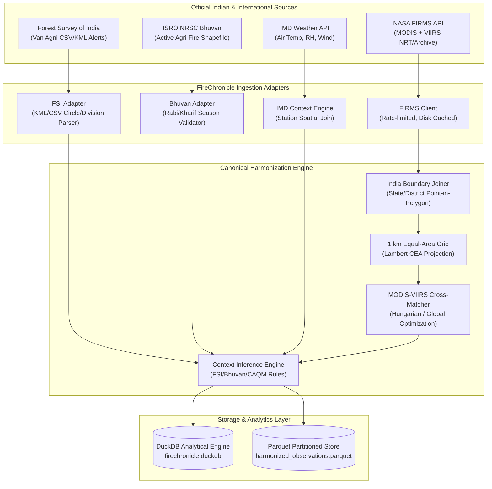

# FireChronicle — India Data Source Register & Provenance Guide
**Document Version:** 1.0.0  
**Research As-Of Date:** 09 November 2026  
**Geographic Domain:** Republic of India (Lat: 6.5°N to 37.1°N, Lon: 68.1°E to 97.4°E)  
**Maintained by:** FireChronicle Scientific Data Engineering Team  

---

## 1. Executive Summary & Objective

This register formally documents the official Indian and international Earth Observation (EO), forestry, agricultural, and meteorological data sources evaluated and integrated for **FireChronicle India**. 

The core mission is to provide **scientifically defensible, transparent satellite fire intelligence** across India by harmonizing NASA FIRMS thermal anomaly observations with Indian jurisdictional context (Forest Survey of India, ISRO/NRSC Bhuvan, IMD, and CAQM standard crop-burning protocols).

Every source is cataloged with its operational URL, data access methodology, credentials requirement, update latency, spatial/temporal resolution, physical channel definitions, known scientific limitations, and official attribution terms.

---

## 2. Exhaustive Data Source Register Table

| # | Source Agency | Dataset / Product Name | Official Portal / URL | India Coverage & Scope | Temporal Coverage & Refresh | Spatial Resolution / Footprint | Key Scientific Attributes | Access Method | Credentials / Auth | Scientific Caveats & Limitations | Licence & Mandatory Attribution | Ingestion Status in MVP |
|---|---------------|------------------------|-----------------------|------------------------|-----------------------------|--------------------------------|---------------------------|---------------|-------------------|-----------------------------------|---------------------------------|-------------------------|
| **1** | **NASA EOSDIS / FIRMS** | MODIS Active Fire (MCD14DL / Collection 6.1) | `https://firms.modaps.eosdis.nasa.gov/api/` | All India (Terra + Aqua passes) | 2000–Present; ~3-4 passes/day; Latency ~3 hrs (NRT) | Nominal 1 km × 1 km nadir pixel | `brightness` (Ch 21/22, K), `bright_t31` (Ch 31, K), `frp` (MW), `confidence` (0–100%), `scan`, `track`, `type` | REST API (Area & Country API), WMS-Time, Archive CSV | Free `MAP_KEY` (Server-side `.env`) | Thermal anomaly pixel, not flame temperature; canopy obscuration, cloud cover; saturated high-intensity fires; 1 km footprint is not fire perimeter | NASA Open Data Policy. Citation: *NASA FIRMS / LANCE EOSDIS* | **ACTIVE (NRT & Archive)** |
| **2** | **NASA EOSDIS / FIRMS** | VIIRS 375m Active Fire (VNP14IMGT, VJ114IMGTDL, VJ214IMGTDL) | `https://firms.modaps.eosdis.nasa.gov/api/area/` | All India (Suomi-NPP, NOAA-20, NOAA-21) | 2012–Present; ~4-6 passes/day; Latency ~2-3 hrs (NRT) | Nominal 375 m × 375 m at nadir | `bright_ti4` (3.74 μm I-4, K), `bright_ti5` (11.45 μm I-5, K), `frp` (MW), `confidence` (low, nominal, high), `scan`, `track` | REST API (Area & Country API), Archive CSV | Free `MAP_KEY` (Server-side `.env`) | Pixel size increases towards swath edge; Suomi-NPP cessation 01-Nov-2026 redirects to NOAA-20/21; detect smaller fires than MODIS | NASA Open Data Policy. Citation: *NASA FIRMS / LANCE EOSDIS* | **ACTIVE (NRT & Archive)** |
| **3** | **Forest Survey of India (FSI), MoEFCC** | Forest Fire Alerts & NRT Point Monitoring | `https://fsiforestfire.gov.in/` | Forest lands across Indian States & UTs | 2004–June 2025 (Archive); Nov 2025–Present (Active Search); 2-4 daily bulletin updates | Point detection (pixel centroid from VIIRS 375m & MODIS 1km) | State, District, Circle, Division, Range, Beat, Fire ID, `sensor`, `latitude`, `longitude`, `acq_datetime` | Web Portal Search, CSV Export, Registered KML | Public portal export; manual KML/CSV upload | Masked by mining/industrial filters; depends on SFD forest administrative boundaries; thermal anomaly alert, not ground-confirmed incident | Government of India MoEFCC / FSI. Citation: *Forest Survey of India (Van Agni)* | **ACTIVE (File Adapter & Provenance)** |
| **4** | **Forest Survey of India (FSI)** | Large Forest Fire (LFF) Monitoring | `https://fsiforestfire.gov.in/LargeForestFire/CurrentLFF` | Fire-prone forest tracts across India | Seasonal tracking (Nov–June); real-time active pass alerts | Cluster of ≥3 contiguous VIIRS 375m pixels | Continuous burn duration, contiguous pixel count, affected division/range | Portal Public View & Bulletin Distribution | No open public REST API; public table view | FSI proprietary internal clustering tracking; indicates candidate large fire, not final burned area | Government of India MoEFCC / FSI. Citation: *FSI Large Forest Fire Monitoring* | **ACTIVE (Rule Classifier & Evidence)** |
| **5** | **ISRO / NRSC Bhuvan** | Active Agricultural Fire (Crop Residue Burning) | `https://bhuvan-app1.nrsc.gov.in/moef/` | Agricultural regions (Punjab, Haryana, UP, Rajasthan, MP, etc.) | Active **only** during Rabi (01 Apr–30 May) and Kharif (15 Sep–30 Nov) | Pixel centroid (MODIS 1km & VIIRS 375m) | State, District, Date, Time, Sensor, Latitude, Longitude | Portal Map Interface, Shapefile Export (`Download Locations`) | Open public export during active seasons; manual Shapefile/GeoJSON import | Inactive outside Rabi/Kharif windows; cloud cover may obscure field burns; weak labels for stubble burning (contextual, not chemical verification) | ISRO / NRSC. Citation: *Bhuvan Indian Geo-Platform of ISRO, NRSC* | **ACTIVE (File Adapter & Season Enforcer)** |
| **6** | **ISRO / NRSC Bhuvan Store** | Forest Type (5 km) & Fire Regime Layers | `https://bhuvan-app1.nrsc.gov.in/2dresources/bhuvanstore2.php` | All India 5 km grid | Baseline 2013 (Forest Type); 2003–2017 (Fire Regime) | 5 km × 5 km grid | Champion & Seth classification, historical fire return frequency | Bhuvan Store Open Download | Free Bhuvan user registration | Historical baseline/contextual layer; not current real-time vegetation status | ISRO / NRSC. Open Government Data. | **ACTIVE (Context Engine Spatial Join)** |
| **7** | **India Meteorological Department (IMD)** | Weather Observation & Forecast API | `https://api.imd.gov.in/public/` & `https://dsp.imdpune.gov.in/` | All India Synoptic Stations & District Forecasts | Hourly / 3-hourly / Daily | Station observations & District centroids | Air Temperature (°C), Relative Humidity (%), Wind Speed (km/h) & Direction, 24h Rainfall (mm) | Public IMD API, DSP Pune Data Service Portal | API Key registration required on `api.imd.gov.in` | Air temperature measured at 2 m in Stevenson screen is **not** brightness temperature or flame temperature; interpolation error in sparse mountainous terrains | IMD Ministry of Earth Sciences (MoES), GoI. Citation: *India Meteorological Department* | **ACTIVE (Contextual Weather Model)** |
| **8** | **NASA GISS / NCCS** | Global Fire Weather Database (GFWED) | `https://data.giss.nasa.gov/impacts/gfwed/` & `https://portal.nccs.nasa.gov/datashare/GlobalFWI/` | Global including South Asia / India | Daily 1980–Present; Daily 0.25°/0.5° grid | ~28 km (0.25°) | Fire Weather Index (FWI), BUI, ISI, DC, DMC, FFMC | HTTPS Datashare NetCDF / OpenDAP | Open Access (No auth required for datashare) | Fire danger rating indicates meteorologically conducive conditions for fire spread, **not** an observation or guarantee of fire ignition | NASA GISS. Citation: *Field et al., Global Fire Weather Database* | **ACTIVE (Methodology & FWI Reference)** |
| **9** | **Commission for Air Quality Management (CAQM) / ISRO** | Standard Protocol for Estimation of Crop Residue Burning | `https://caqm.nic.in/WriteReadData/LINKS/32-64813c12-1ca4-45c7-a6a2-1239ec795085.pdf` | Punjab, Haryana, Delhi NCR, UP, Rajasthan | Mandatory agricultural monitoring protocol (August 2021 / April 2025 Framework) | Multi-sensor integration (VIIRS 375m + MODIS + Sentinel-2 post-harvest) | Event detection protocol, persistent thermal anomaly criteria, agricultural land mask | Official Regulatory Circular / Technical Protocol | Public Government Document | Requires cross-referencing satellite pass times with ground agricultural calendars; single satellite pass undercounts short-lived afternoon residue fires | CAQM / Ministry of Environment, Forest and Climate Change | **ACTIVE (Context Inference Rules)** |
| **10** | **ESA / Copernicus** | ESA WorldCover 10m Global Land Cover | `https://esa-worldcover.org/en/data-access` | All India (10m grid) | V100 (2020), V200 (2021) | 10 m × 10 m Sentinel-1 & Sentinel-2 composite | Classes: Tree cover (10), Shrubland (20), Grassland (30), Cropland (40), Built-up (50), Bare/sparse (60), Water (80) | Cloud-Optimized GeoTIFF (COG), Terrascope STAC | Open Access (Creative Commons CC BY 4.0) | High resolution but static 2020/2021 snapshot; seasonal crop rotations not captured continuously; inter-version methodology differences | ESA WorldCover project / European Space Agency | **ACTIVE (Cropland/Tree Cover Context Lookup)** |
| **11** | **NASA LP DAAC / USGS** | MCD64A1 MODIS Burned Area Product | `https://ladsweb.modaps.eosdis.nasa.gov/missions-and-measurements/products/MCD64A1` | Global including India | Monthly composite, 2000–Present | 500 m × 500 m sinusoidal grid | `Burn Date` (day of year 1–366), `BurnDateUncertainty`, `QC` | Earthdata HTTPS / AppEEARS | NASA Earthdata Login | Post-fire burn scar mapping; not a near-real-time alert; cloud and rapid regrowth in tropical vegetation can mask burn scars | NASA LP DAAC. Citation: *Giglio et al., MCD64A1 Collection 6* | **ACTIVE (Post-Event Burn Scar Validation)** |

---

## 3. Scientific Disclaimers & Integrity Contracts

### 3.1 Satellite Hotspots Are Thermal Anomalies, Not Confirmed Fires
- An active-fire detection from MODIS or VIIRS indicates that a subpixel thermal emission exceeded the contextual statistical background threshold in the 3.7–4.0 μm channel.
- It is **not** ground confirmation of a wildfire. Possible heat sources include agricultural residue burning, controlled prescribed burns, industrial flare stacks, brick kilns, steel mills, or sun glint (partially filtered).
- Unobserved areas during satellite overpasses or pixels obscured by dense monsoon clouds, heavy smoke, or thick forest canopy do not constitute proof of zero fire activity.

### 3.2 Brightness Temperature vs. Flame Temperature vs. Air Temperature
- **Brightness Temperature (Kelvin):** The temperature of a blackbody emitting the identical spectral radiance measured by the satellite sensor in a specific infrared channel (e.g., VIIRS Band I-4 at 3.74 μm or Band I-5 at 11.45 μm). Because active fires typically occupy only a small fraction (0.01%–1%) of a 375 m or 1 km pixel, the satellite brightness temperature is an area-weighted pixel average and is substantially lower than the actual flame combustion temperature (800–1200 K).
- **Fire Radiative Power (MW):** Radiative energy emitted per second by the subpixel combustion process, estimated using the 4 μm radiance anomaly. FRP is **not** a measure of temperature, burned area, or fire count.
- **Air Temperature (°C):** The ambient thermodynamic temperature of the atmosphere measured at 2 meters above ground level by IMD meteorological stations in a shaded Stevenson screen. It must never be confused with satellite brightness temperature.

### 3.3 Sensor Footprint & Resolution Differences
- **MODIS:** Nominal nadir footprint is ~1.0 km × 1.0 km (~100 ha). At swath edges (scan angle ~55°), the footprint expands to ~2.0 km scan × ~4.8 km track due to optical projection distortion.
- **VIIRS (I-band 375m):** Employs active pixel aggregation to constrain footprint growth from 375 m at nadir to ~800 m at swath edge. VIIRS detects fires up to 10× smaller and of lower intensity than MODIS.
- **Harmonization Grid:** Spatial comparisons must use an equal-area projected grid (e.g. Lambert Cylindrical Equal-Area or Indian metric projected grid) rather than unprojected degree bins.

---

## 4. Ingestion & Storage Architecture



---

## 5. Provenance Manifest Schema

Every data batch ingested into FireChronicle generates an immutable JSON sidecar manifest:

```json
{
  "batch_id": "BATCH-20261109-INDIA-01",
  "ingested_at_utc": "2026-11-09T10:45:00Z",
  "source_agency": "NASA_FIRMS",
  "source_product": "VIIRS_NOAA20_NRT",
  "geographic_envelope": {
    "west": 68.1,
    "south": 6.5,
    "east": 97.4,
    "north": 37.1
  },
  "raw_file_hash": "sha256:4f8a29b...",
  "records_received": 1420,
  "records_validated": 1420,
  "records_rejected": 0,
  "rejection_reasons": {},
  "attribution": "NASA FIRMS, LANCE EOSDIS",
  "license": "NASA Open Data Policy"
}
```
