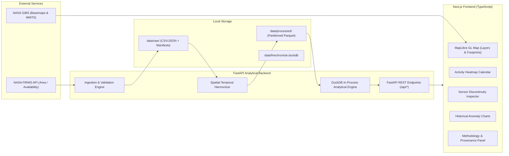

# FireChronicle System Architecture

**Document:** Architecture Design & Engineering Specification  
**System:** FireChronicle  
**Version:** 1.0 (Pre-Hackathon Preparation)

---

## 1. System Overview & Technology Stack

FireChronicle is designed as a modular, lightweight, and deployable geospatial analytical application. It couples a Python/FastAPI data harmonization engine with an interactive Next.js/React frontend dashboard.



### 1.1 Backend Stack
- **Framework:** FastAPI with Uvicorn (asynchronous, high performance, automatic OpenAPI documentation).
- **Validation:** Pydantic v2 schemas for all request parameters and response models.
- **Analytical Storage & Query:** DuckDB for SQL execution over Parquet and CSV files; pandas and PyArrow for tabular transformations.
- **Geospatial Processing:** GeoPandas, Shapely, and pyproj for coordinate transforms and distance calculation.
- **Quality & Testing:** pytest, Ruff (linting), mypy (type checks).

### 1.2 Frontend Stack
- **Framework:** Next.js (App Router) + React 19 + TypeScript.
- **Styling:** Tailwind CSS (deep navy/neutral theme with thermal orange/red hotspot accents).
- **Interactive Mapping:** MapLibre GL JS (high-performance WebGL rendering for thousands of hotspot vectors and satellite footprints) or Leaflet fallback.
- **Data Visualization:** Recharts for time series, calendar heatmaps, and FRP distribution plots.

---

## 2. API Endpoints Specification

All backend endpoints are strictly validated and bounded to prevent denial-of-service, runaway memory usage, or filesystem traversal.

### 2.1 Health & Diagnostics
- **`GET /api/health`**
  - **Purpose:** Verifies backend service status, memory usage, DuckDB connectivity, and environment flag (`development`/`production`).
  - **Response:**
    ```json
    {
      "status": "healthy",
      "timestamp": "2026-10-25T22:30:00Z",
      "version": "1.0.0",
      "firms_configured": true,
      "duckdb_ready": true
    }
    ```
  - *Note:* Never returns actual API keys or secret values.

### 2.2 Metadata & Product Capabilities
- **`GET /api/metadata`**
  - **Purpose:** Returns list of supported satellite products, available date ranges, preset AOIs, and latest data retrieval timestamps.
  - **Response:**
    ```json
    {
      "sensors": ["MODIS", "VIIRS"],
      "platforms": ["Terra", "Aqua", "Suomi-NPP", "NOAA-20", "NOAA-21"],
      "products": ["MODIS_SP", "MODIS_NRT", "VIIRS_SNPP_SP", "VIIRS_NOAA20_SP"],
      "preset_aois": [
        {"id": "california", "name": "California, USA", "bbox": [-124.5, 32.5, -114.1, 42.0]},
        {"id": "pantanal", "name": "Pantanal, Brazil", "bbox": [-59.0, -22.0, -55.0, -16.0]},
        {"id": "nsw_australia", "name": "New South Wales, Australia", "bbox": [140.9, -37.5, 153.6, -28.1]}
      ],
      "active_mode": "PRE_HACKATHON_PREPARATION"
    }
    ```

### 2.3 Observations Query
- **`GET /api/observations`**
  - **Query Parameters:**
    - `bbox`: Comma-separated `west,south,east,north` (float, bounded $-180 \le lon \le 180$, $-90 \le lat \le 90$).
    - `start_date`, `end_date`: `YYYY-MM-DD` strings.
    - `sensor`: Optional filter (`MODIS`, `VIIRS`, or `ALL`).
    - `classification`: Optional filter (`matched`, `MODIS_only`, `VIIRS_only`, or `ALL`).
    - `limit`: Integer (1 to 10,000, default 1,000).
    - `offset`: Integer (paging offset).
  - **Response:** Paginated GeoJSON FeatureCollection or normalized JSON records with total count and provenance metadata.

### 2.4 Burning-Activity Calendar
- **`GET /api/calendar`**
  - **Query Parameters:** `bbox`, `start_date`, `end_date`, `grid_resolution_km` (default 1.0).
  - **Response:** Daily and monthly aggregated summaries containing:
    - `date`: `YYYY-MM-DD`
    - `modis_raw_count`: integer
    - `viirs_raw_count`: integer
    - `unique_active_cells`: integer (harmonized count)
    - `matched_active_cells`: integer
    - `modis_only_cells`: integer
    - `viirs_only_cells`: integer
    - `mean_frp_modis`: float (MW)
    - `mean_frp_viirs`: float (MW)
    - `coverage_flag`: `'full'`, `'partial'`, or `'no_pass'`

### 2.5 Cross-Sensor Comparison & Discontinuity Analysis
- **`GET /api/compare`**
  - **Query Parameters:** `bbox`, `start_date`, `end_date`, `spatial_tolerance_m` (default 1000), `temporal_tolerance_min` (default 60).
  - **Response:**
    - `matched_count`: integer
    - `modis_only_count`: integer
    - `viirs_only_count`: integer
    - `frp_distribution`: Quantiles (p25, p50, p75, p95) for MODIS and VIIRS
    - `spatial_agreement_jaccard`: float (0.0 to 1.0)
    - `matching_sensitivity`: Array of match fractions at varying distance tolerances (500m, 1000m, 1500m, 2000m).

### 2.6 Historical Anomalies & Seasonality
- **`GET /api/anomalies`**
  - **Query Parameters:** `bbox`, `target_year`, `target_month`.
  - **Response:** Historical baseline monthly median, MAD, and current deviation score ($Z_{robust}$) with explicit baseline sample-size caveats.

### 2.7 Safe Local Ingestion
- **`POST /api/import`**
  - **Purpose:** Ingests an authorized local CSV file for offline or air-gapped evaluation. Validates headers, coordinates, and sizes strictly. Rejects unauthorized paths.

---

## 3. Directory Layout & Repository Structure

```text
c:\Users\bhavishya\Downloads\PROJECTS\Nasa\
├── .env.example              # Environment template with blank placeholders
├── .gitignore                # Protects secrets, node_modules, .venv, and raw data
├── README.md                 # Project manifesto, mode, and execution instructions
├── docs/                     # Architectural, scientific, and compliance documents
│   ├── official_challenge_requirements.md
│   ├── data_sources.md
│   ├── environment.md
│   ├── methodology.md
│   ├── architecture.md
│   └── model_card.md
├── data/
│   ├── raw/                  # Original ingested FIRMS CSVs (git-ignored)
│   ├── processed/            # Cleaned Parquet records & DuckDB files (git-ignored)
│   └── sample/               # Explicitly labelled synthetic testing fixtures
├── backend/                  # FastAPI backend service
│   ├── app/
│   │   ├── main.py           # FastAPI entrypoint
│   │   ├── config.py         # Settings & environment validation
│   │   ├── api/              # Route handlers
│   │   ├── services/         # Ingestion, matching, and aggregation logic
│   │   ├── schemas/          # Pydantic models
│   │   └── analytics/        # Robust seasonal baseline & statistics
│   ├── tests/                # Automated pytest suite
│   └── requirements.txt      # Pinned Python dependencies
└── frontend/                 # Next.js frontend application
    ├── src/
    │   ├── app/              # Next.js App Router pages
    │   ├── components/       # Map, Calendar, Comparison, Provenance widgets
    │   ├── lib/              # API clients and coordinate utilities
    │   └── types/            # TypeScript definitions
    ├── package.json
    └── tailwind.config.js
```

---

## 4. Security, Secrets & Reliability Controls

1. **MAP_KEY Isolation:** The NASA FIRMS MAP_KEY is loaded exclusively server-side via `config.py` from `.env`. It is never delivered to the client, logged to console, or passed as a URL query parameter visible in client network tabs.
2. **Offline / Fallback Resilience:** When the live FIRMS API is unreachable or when the user does not possess an active MAP_KEY, the backend transparently falls back to cached processed data or small sample fixtures with clear visual UI banners indicating cached/sample status.
3. **Bound Inputs & Memory Protection:** All bounding box and date queries are clamped. Maximum query durations are limited to 30 days per live request to prevent memory exhaustion on the 8 GB host machine.
