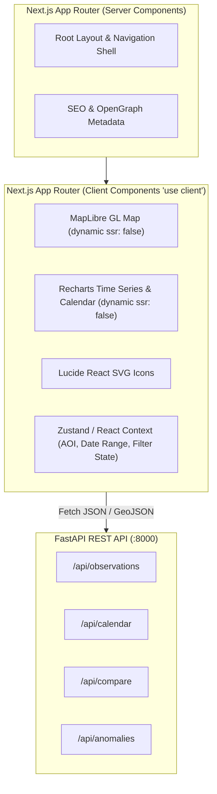

# FireChronicle Frontend Architecture & Integration Specification

**System:** FireChronicle Web Client  
**Framework:** Next.js (App Router) + React + TypeScript + Tailwind CSS  
**Target Event:** NASA International Space Apps Challenge 2026  
**Document Status:** Pre-Hackathon Frontend Readiness Specification  
**Current Operating Mode:** `PRE_HACKATHON_PREPARATION`

---

## 1. Environment & Runtime Inspection

The frontend build environment was directly verified on the host system:

- **Node.js Runtime:** `v24.18.0` (64-bit AMD64). Confirmed active and functional.
- **Package Manager:** `npm 11.16.0` (Note: Invoked via `npm.cmd` in PowerShell to bypass Windows script execution policies).
- **Global Package Registries:** Verified reachability to registry.npmjs.org for Next.js, MapLibre GL, Recharts, and Lucide React.
- **Physical Memory Availability:** ~1.92 GB free out of 8.16 GB RAM. The frontend development server (`next dev`) and production build (`next build`) require constrained heap limits (`NODE_OPTIONS="--max-old-space-size=2048"`).

---

## 2. Framework & Library Compatibility Analysis



### 2.1 Next.js + React + TypeScript + Tailwind CSS
- **Next.js (v14.2.x or v15.x):** Fully compatible with Node.js 24. Supports fast client navigation and API rewrites/proxies.
- **TypeScript (v5.x):** Provides strict type enforcement between the FastAPI Pydantic models and frontend data interfaces.
- **Tailwind CSS (v3.4.x):** Utility-first styling enabling a disciplined scientific theme (deep navy `#0B132B`, slate surface `#1C2541`, thermal orange `#F77F00`, thermal red `#D62828`, high-contrast text `#F4F4F9`).

### 2.2 Mapping: MapLibre GL JS (`maplibre-gl`)
- **Compatibility Consideration:** MapLibre GL JS directly accesses browser globals (`window`, `document`, WebGLRenderingContext).
- **Engineering Rule:** Map components **must** be implemented as client components with dynamic imports disabling server-side rendering:
  ```typescript
  import dynamic from 'next/dynamic';
  const HotspotMap = dynamic(() => import('@/components/map/HotspotMap'), { ssr: false });
  ```
- **Tile Sources:** Consumes NASA GIBS (Global Imagery Browse Services) WMTS raster tiles for satellite basemaps (Terra/Aqua True Color) alongside OpenStreetMap/Carto basemap tiles.

### 2.3 Charting: Recharts (`recharts`)
- **Compatibility Consideration:** Recharts uses SVG and relies on client-side container measurement (`ResponsiveContainer`). React 19 introduced peer-dependency warnings with older Recharts builds.
- **Engineering Rule:** Pin `recharts` to `~2.13.0` or `~3.x` with verified React compatibility. Render chart containers only after the client has mounted (`mounted` state check) to eliminate SSR hydration mismatches.

### 2.4 Icons: Lucide React (`lucide-react`)
- **Compatibility Consideration:** Completely tree-shakeable, pure SVG React components. Zero SSR friction or runtime overhead.

---

## 3. Hackathon Build Initialization Commands

On November 14, 2026, when `HACKATHON_BUILD` mode is activated, the frontend will be initialized with the following exact commands:

```powershell
# Navigate to repository root
cd c:\Users\bhavishya\Downloads\PROJECTS\Nasa

# Initialize Next.js with TypeScript, Tailwind CSS, and App Router in frontend/
npm.cmd create next-app@14.2.15 frontend --typescript --tailwind --eslint --app --src-dir --import-alias "@/*" --use-npm

# Navigate to frontend directory
cd frontend

# Install mapping, charting, and icon packages
npm.cmd install maplibre-gl recharts lucide-react clsx tailwind-merge
npm.cmd install -D @types/maplibre-gl

# Verify initial production build
npm.cmd run build
```

---

## 4. Proposed Component Architecture

The interface is organized into modular components adhering to scientific clarity:

```text
frontend/src/
├── app/
│   ├── layout.tsx                     # Root layout with header, navigation, and footer
│   ├── page.tsx                       # Main dashboard assembling core views
│   └── globals.css                    # Tailwind imports and theme variables
├── components/
│   ├── layout/
│   │   ├── Header.tsx                 # Brand, NASA Space Apps 2026 badge, Mode indicator
│   │   ├── AoiSelector.tsx            # Bounding box / preset selector (California, Pantanal, etc.)
│   │   ├── DateRangePicker.tsx        # Temporal window controls (1–30 days)
│   │   └── ProvenanceFooter.tsx       # NASA FIRMS citation, sensor versions, download timestamps
│   ├── overview/
│   │   ├── MetricsSummaryGrid.tsx     # Total hotspots, unique active cells, matched fraction, peak FRP
│   │   ├── SensorBreakdownCards.tsx   # MODIS vs VIIRS detection counts and platform distribution
│   │   └── ActivityMiniTrend.tsx      # Sparkline timeline of observations across the selected period
│   ├── map/
│   │   ├── HotspotMap.tsx             # MapLibre GL instance with WebGL canvas
│   │   ├── LayerControls.tsx          # Toggles: MODIS (1km), VIIRS (375m), Matched, Harmonized Cells
│   │   ├── FootprintLegend.tsx        # Visual representation of 1km vs 375m pixel footprints
│   │   └── DetectionPopup.tsx         # Detailed attributes (acq_time, confidence, FRP, platform)
│   ├── calendar/
│   │   ├── BurningActivityCalendar.tsx# Central heatmap matrix (months vs days across historical years)
│   │   ├── MetricToggleBar.tsx        # Toggle: 'Raw Detection Count' vs 'Unique Active Cells'
│   │   ├── CoverageIndicator.tsx      # Legend: Detection, Zero Fire, Satellite Gap, Cloud Obscured
│   │   └── DayDetailModal.tsx         # Drilldown modal showing detections on clicked calendar cell
│   ├── compare/
│   │   ├── DiscontinuityInspector.tsx # Side-by-side sensor comparison dashboard
│   │   ├── FootprintResolutionViz.tsx # Interactive diagram showing why VIIRS detects 3x-10x more points
│   │   ├── MatchedUnmatchedChart.tsx  # Bar chart: Plausible matches vs sensor-specific detections
│   │   ├── FrpDistributionBoxPlot.tsx # Box-and-whisker plot comparing MODIS and VIIRS FRP (MW)
│   │   └── ToleranceSensitivity.tsx   # Slider (500m to 2000m) demonstrating matching sensitivity
│   └── provenance/
│       ├── MethodologyDrawer.tsx      # Step-by-step description of the 11-stage pipeline
│       ├── DataSourceRegister.tsx     # Table of products, versions, resolutions, and retrieval dates
│       └── CaveatsBanner.tsx          # Explicit disclaimer: Hotspots ≠ confirmed wildfires
├── lib/
│   ├── api.ts                         # Typed fetch client connecting to FastAPI backend
│   └── geo.ts                         # Bounding box and coordinate helper utilities
└── types/
    └── index.ts                       # Shared TypeScript interfaces
```

---

## 5. Expected Backend API Contract (TypeScript Definitions)

The frontend client will communicate with the FastAPI backend through strongly-typed contracts:

```typescript
// frontend/src/types/index.ts

export type SensorType = 'MODIS' | 'VIIRS';
export type PlatformType = 'Terra' | 'Aqua' | 'Suomi-NPP' | 'NOAA-20' | 'NOAA-21';
export type ConfidenceCategory = 'low' | 'nominal' | 'high';
export type ClassificationType = 'matched' | 'MODIS_only' | 'VIIRS_only';
export type CoverageStatus = 'full' | 'partial' | 'no_pass' | 'cloud_obscured';

/** GET /api/health response */
export interface HealthResponse {
  status: 'healthy' | 'degraded';
  timestamp: string;
  version: string;
  firms_configured: boolean;
  duckdb_ready: boolean;
  active_mode: 'PRE_HACKATHON_PREPARATION' | 'HACKATHON_BUILD';
}

/** Normalized hotspot observation item */
export interface ObservationRecord {
  observation_id: string;
  sensor: SensorType;
  platform: PlatformType;
  latitude: number;
  longitude: number;
  acq_datetime_utc: string;
  acq_date_utc: string;
  acq_time_utc: string;
  confidence_category: ConfidenceCategory;
  raw_confidence: string | number;
  frp_mw: number | null;
  daynight: 'D' | 'N';
  classification: ClassificationType;
  matched_pair_id?: string;
  spatial_resolution_m: number;
}

/** GET /api/calendar day summary */
export interface CalendarDaySummary {
  date: string;
  modis_raw_count: number;
  viirs_raw_count: number;
  total_raw_count: number;
  unique_active_cells: number;
  matched_cells: number;
  modis_only_cells: number;
  viirs_only_cells: number;
  mean_frp_modis: number | null;
  mean_frp_viirs: number | null;
  coverage_status: CoverageStatus;
}

/** GET /api/compare response */
export interface SensorComparisonResponse {
  time_window: { start_date: string; end_date: string };
  bounding_box: [number, number, number, number];
  modis_total_detections: number;
  viirs_total_detections: number;
  matched_pairs_count: number;
  modis_only_count: number;
  viirs_only_count: number;
  spatial_agreement_jaccard: number;
  frp_quantiles: {
    modis: { p25: number; p50: number; p75: number; p95: number };
    viirs: { p25: number; p50: number; p75: number; p95: number };
  };
  sensitivity_curve: Array<{ tolerance_m: number; matched_fraction: number }>;
}
```

---

## 6. Implementation Checklist & Integration Risk Register

### 6.1 Frontend Execution Checklist (November 14, 2026)
- [ ] Initialize `frontend/` project using `npm.cmd create next-app`.
- [ ] Configure Tailwind theme with scientific palette in `tailwind.config.js`.
- [ ] Create API client service in `src/lib/api.ts` pointing to `process.env.NEXT_PUBLIC_API_BASE_URL`.
- [ ] Implement layout shell: Header, AOI bounding box picker, Date picker, and Provenance footer.
- [ ] Implement `HotspotMap.tsx` with dynamic client-only import and MapLibre GL layer controls.
- [ ] Implement `BurningActivityCalendar.tsx` with cell metric toggle (`raw_detection_count` vs `unique_active_cells`).
- [ ] Implement `DiscontinuityInspector.tsx` side-by-side charts.
- [ ] Connect frontend to running FastAPI backend and verify real-time data filtering.
- [ ] Run production build `npm.cmd run build` and resolve any type/lint errors.

### 6.2 Key Integration Risks & Mitigations

| Risk | Impact | Pre-Engineered Mitigation |
| :--- | :--- | :--- |
| **SSR Crash on MapLibre GL (`window is not defined`)** | High (Build / Runtime failure) | Enforce `dynamic(() => import(...), { ssr: false })` on all map components; verify client-only lifecycle. |
| **High Point Density (10,000+ points crashing DOM)** | High (Browser freeze / lag) | Avoid individual React DOM markers. Use MapLibre GL native GeoJSON vector source and WebGL circle layer with GPU clustering. |
| **CORS Errors between Next.js (3000) and FastAPI (8000)** | Medium (API fetch blocked) | Configure FastAPI `CORSMiddleware` with `allow_origins=["http://localhost:3000", "http://127.0.0.1:3000"]`. |
| **Timezone Calendar Shift** | Medium (Scientific inaccuracy) | Standardize all date grouping on UTC ISO dates (`YYYY-MM-DD`). Never convert dates to local user timezone before aggregation. |
| **Recharts React 19 Peer Conflict** | Medium (npm install failure) | Pin Recharts to verified version or install with `--legacy-peer-deps` if React 19 is chosen by `create next-app`. |
| **PowerShell Script Policy** | Low (Command failure) | Always invoke `npm.cmd` rather than `npm` in PowerShell commands. |
