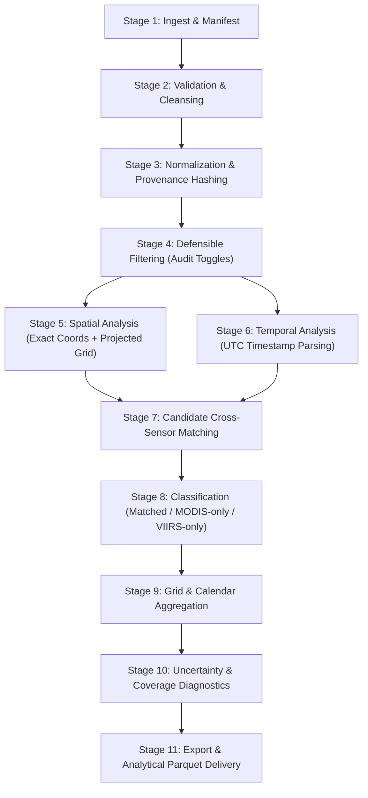

# Scientific Harmonization Methodology

**Document:** Cross-Sensor MODIS and VIIRS Harmonization Pipeline  
**System:** FireChronicle  
**Version:** 1.0-Specification (Pre-Hackathon Preparation)

---

## 1. Scientific Problem & Discontinuity Analysis

### 1.1 The Cross-Sensor Gap
From 2000 to 2012, MODIS (Terra/Aqua) was the primary global satellite active-fire observation system. With the launch of Suomi-NPP (2011), NOAA-20 (2017), and NOAA-21 (2022), VIIRS active-fire products became operational. VIIRS offers higher spatial resolution (375 m vs 1 km) and different spectral response characteristics.

Direct concatenation of raw MODIS and VIIRS records results in severe artificial trends:
1. **Resolution Bias:** A single 1 km MODIS detection footprint covers ~1,000,000 m². In the same physical area, VIIRS 375 m (~140,625 m²) can resolve multiple distinct fire pixels or detect smaller, cooler fires below MODIS's detection threshold. VIIRS point counts typically exceed MODIS by a factor of 3× to 10× over identical fire events.
2. **Scan Geometry & Bow-Tie Effect:** MODIS pixel size expands significantly toward the scan edges (up to 2 km × 4.8 km), duplicating detections across consecutive scan lines. VIIRS utilizes onboard 3-pixel aggregation that constrains pixel expansion to ~750 m at the scan edge.
3. **Overpass Timing Discrepancies:**
   - Terra: ~10:30 AM/PM local solar time.
   - Aqua: ~13:30 AM/PM local solar time.
   - Suomi-NPP: ~13:30 AM/PM local solar time.
   - NOAA-20: Orbits ~50 minutes separated from Suomi-NPP (~13:30 local solar time).
   - Diurnal fire cycles mean that morning passes (Terra) and afternoon passes (Aqua/VIIRS) observe drastically different fire intensities.
4. **Fire Radiative Power (FRP):** While both measure radiant thermal energy in Megawatts (MW), FRP estimation algorithms differ across sensors, band configurations, and atmospheric corrections. FRP from overlapping records cannot be summed directly.

---

## 2. Eleven-Stage Harmonization Pipeline

### Stage 1: Ingestion & Retrieval Manifest
- Fetch active-fire observations via NASA FIRMS Area API or bulk archive CSV.
- Record an immutable ingest manifest per retrieval: `retrieval_timestamp_utc`, `source_product` (e.g. `MODIS_SP`, `VIIRS_NOAA20_SP`), `date_range`, `bounding_box`, `record_count`, `checksum_sha256`.
- Save raw unmodified bytes into `data/raw/`.

### Stage 2: Schema Validation & Integrity Cleansing
- Verify field presence and data types.
- Check latitude range ($-90.0 \le \text{lat} \le 90.0$) and longitude ($-180.0 \le \text{lon} \le 180.0$).
- Reject or flag physically impossible FRP ($FRP < 0$ or $FRP > 50,000 \text{ MW}$).
- Detect exact duplicate records (same sensor, identical coordinates, same acquisition time).
- Distinguish explicit nulls from zero values.

### Stage 3: Normalization & Immutable Provenance Hashing
Map heterogeneous source columns into a unified scientific schema while preserving all raw fields:
- `observation_id`: SHA-256 hash of `(source_file, source_row_id, sensor, platform, latitude, longitude, acq_datetime_utc)`.
- `sensor`: `'MODIS'` or `'VIIRS'`.
- `platform`: `'Terra'`, `'Aqua'`, `'Suomi-NPP'`, `'NOAA-20'`, or `'NOAA-21'`.
- `processing_status`: `'SP'` (Standard Science Quality) or `'NRT'` (Near Real-Time).
- `acq_datetime_utc`: ISO 8601 UTC timestamp calculated from `acq_date` (`YYYY-MM-DD`) and `acq_time` (`HHMM`).
- `raw_confidence`: Preserves original sensor value (e.g. `85` for MODIS, `'high'` for VIIRS).
- `confidence_category`: Mapped standard category (`low`, `nominal`, `high`) based on official documentation:
  - MODIS: Low (<30%), Nominal (30–80%), High (>80%).
  - VIIRS: Preserves native `'low'`, `'nominal'`, `'high'`.

### Stage 4: Defensible Filtering (Audit Toggles)
- Provide user-configurable filters with complete impact visibility.
- Never silently drop low-confidence records; provide a toggle to assess sensitivity.
- Support filtering by anomaly type (vegetation fire vs volcano vs industrial gas flare).

### Stage 5: Spatial Analysis & Common Grid
- Maintain high-precision WGS84 point coordinates for exact geospatial operations.
- Generate a common equal-area analysis grid (defaulting to ~1 km equal-area hexagonal or rectangular cells, configurable from 500 m to 5 km).
- Spatial indexing using spatial hashing or projected coordinates (EPSG:3857 for display, local equal-area projection like EPSG:6933 for physical distance metrics).

### Stage 6: Temporal Analysis & Overpass Synchronization
- Observations on the same calendar date are **not** treated as simultaneous.
- Real acquisition timestamps are used for inter-sensor candidate matching.
- Calendar aggregations partition by calendar date (UTC and local solar day).

### Stage 7: Candidate Cross-Sensor Matching Logic
Two observations $obs_{MODIS}$ and $obs_{VIIRS}$ are identified as a *candidate cross-sensor match* if and only if:
1. **Temporal Proximity:** $|\Delta t| \le \Delta t_{max}$ (default $\Delta t_{max} = 60\text{ minutes}$, corresponding to near-synchronous afternoon orbits such as Aqua and Suomi-NPP/NOAA-20).
2. **Spatial Proximity:** $\text{Distance}(obs_{MODIS}, obs_{VIIRS}) \le d_{max}$ (default $d_{max} = 1.0\text{ km}$, reflecting the combined 1 km MODIS footprint and 375 m VIIRS footprint).
- If multiple VIIRS detections fall within a single MODIS footprint, the match relationship is recorded as one-to-many (`modis_id` linked to list of `viirs_ids`).
- The matched pair records distance in meters, time difference in minutes, and relative angle.

### Stage 8: Scientific Classification
Each detection is categorized:
- `matched`: Observation has a plausible cross-sensor counterpart within tolerances.
- `MODIS_only`: MODIS detection with no corresponding VIIRS detection during overpass window (e.g. cloud gap, short-lived fire, or morning Terra overpass).
- `VIIRS_only`: VIIRS detection with no MODIS counterpart (e.g. smaller fire below MODIS detection threshold, NOAA-20 orbit offset, or sub-kilometer spatial resolution advantage).

> [!NOTE]
> A candidate cross-sensor match denotes collocated thermal radiation observed across instruments; it is not definitive ground truth that both sensors viewed identical flame fronts.

### Stage 9: Grid & Calendar Aggregation

#### The Activity Calendar Metrics
To prevent misleading historical trends, FireChronicle defines two core transparent metrics:
1. `raw_detection_count`:
   $$\text{Count}_{sensor}(grid, day) = \sum \mathbf{1}_{obs \in (grid, day)}$$
   Reported separately for MODIS and VIIRS.
2. `unique_active_cells`:
   $$\text{ActiveCells}(AOI, day) = |\{ grid\_id : \exists obs \in (grid\_id, day) \}|$$
   Counts distinct spatial cells containing at least one thermal anomaly. This dramatically reduces resolution bias because multi-point VIIRS clusters within a single 1 km cell collapse to 1 active cell, yielding direct comparability to MODIS.
3. `harmonized_activity_index`:
   A composite metric expressing unique active cells weighted by observation coverage, transparently documented in the interface.

### Stage 10: Quality, Coverage & Uncertainty Diagnostics
- Report sensor coverage status for every calendar day: `Active Observation`, `No Detection`, `Satellite Gaps / No Pass`, or `Missing / Unprocessed`.
- Compute the **Matched Fraction**:
  $$\text{Matched Fraction}_{MODIS} = \frac{|MODIS_{matched}|}{|MODIS_{total}|}$$
- Evaluate sensitivity by varying $d_{max}$ (0.5 km to 2.0 km) and $\Delta t_{max}$ (30 to 120 min).

### Stage 11: Export & Analytical Parquet Delivery
- High-performance analytical storage via DuckDB and partitioned Parquet.
- Filtered CSV export for researchers and emergency managers including provenance metadata headers.

---

## 3. Fire Radiative Power (FRP) Treatment

1. **Conservation of Measurement Integrity:** Raw FRP values in MW are always preserved alongside original sensor tags.
2. **Strict Prohibition of Double Counting:** When MODIS and VIIRS observe the same active fire during overlapping overpasses, their FRP values are **never summed**.
3. **Optional Empirical Calibration (Held-Out Validation):**
   - If cross-sensor FRP calibration is evaluated, it is fitted strictly on matched pairs during synchronous afternoon overpasses (Aqua vs S-NPP/NOAA-20).
   - Validation uses strict temporal or regional holdouts (e.g. fit on Year $N-1$, test on Year $N$) to prevent spatial autocorrelation leakage.
   - Metrics reported: Mean Absolute Error (MAE), Root Mean Square Error (RMSE), and Mean Bias before and after adjustment.
   - If calibration does not yield statistically robust improvement, the default remains unadjusted raw FRP per sensor.

---

## 4. Anomaly Detection & Historical Baselines

### 4.1 Robust Seasonal Baseline (Primary Method)
- For each grid cell or AOI, calculate historical burning activity for each calendar month/week across multi-year history (e.g. 5–10 years).
- Use robust non-parametric statistics resistant to extreme wildfire outliers:
  - **Baseline Center:** $\text{Median}(X_{historical})$
  - **Baseline Dispersion:** $\text{MAD} = \text{Median}(|X - \text{Median}(X)|)$ or Interquartile Range (IQR).
- **Deviation Score ($Z_{robust}$):**
  $$Z_{robust} = \frac{X_{current} - \text{Median}}{\text{MAD} \times 1.4826}$$
- **Safeguard:** Do not report anomaly scores for regions/periods with fewer than 3 historical observation years or where sensor coverage was incomplete.

### 4.2 Light Supervised / Unsupervised ML (Secondary / Optional)
- IsolationForest or robust linear models are applied exclusively on aggregated spatiotemporal feature vectors (`unique_active_cells`, `mean_frp`, `month_sin`, `month_cos`), never on unverified raw point rows.
- Documented via a dedicated Model Card (`docs/model_card.md`).
