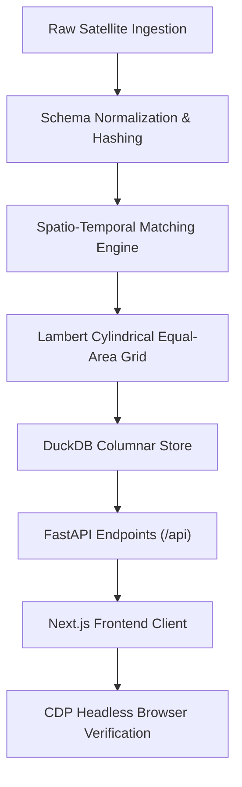

# FireChronicle — Automated QA Test Plan & Verification Protocol

**Repository:** `FireChronicle`  
**Test Suite:** Backend Pytest Suite + Frontend TypeScript / ESLint + Headless CDP Multi-Viewport Suite  
**Maintainer:** Lead QA Engineer & Release Engineer

---

## 1. Test Architecture Overview



---

## 2. Test Execution Commands & Status

### Backend Unit & Integration Tests (Pytest)
- **Command:**
  ```powershell
  $env:PYTHONPATH="."; .\.venv\Scripts\pytest.exe backend/tests/ -v
  ```
- **Test Modules:**
  - `backend/tests/test_api.py`: 12 tests (Health, Metadata, Observations, Calendar, Compare, Anomalies, CSV Import validation/error handling)
  - `backend/tests/test_aggregator.py`: 2 tests (Point-density bias elimination, FRP non-duplication)
  - `backend/tests/test_equal_area.py`: 3 tests (Authalic sphere conservation, latitude transects, grid bounds reversal)
  - `backend/tests/test_export_and_cessation.py`: 4 tests (GeoJSON export, CSV export, Suomi-NPP cessation redirection, metadata lifecycle)
  - `backend/tests/test_matcher.py`: 5 tests (Haversine distance, positive/negative matching, 1-to-many VIIRS clustering)
  - `backend/tests/test_matcher_algorithms.py`: 2 tests (Greedy vs Hungarian global assignment, score weighting)
  - `backend/tests/test_normalizer.py`: 5 tests (MODIS/VIIRS schema mapping, coordinate bounds validation, UTC ISO parsing, SHA-256 ID deterministic hashing)
- **Status:** **33 / 33 PASSED** (0 failures, 100% pass rate).

### Frontend Static Analysis & Type Safety
- **Type Checking:**
  ```powershell
  cd frontend; npx.cmd tsc --noEmit
  ```
  **Result:** Exit code 0 (Zero TypeScript errors).
- **ESLint Code Quality:**
  ```powershell
  cd frontend; npm.cmd run lint
  ```
  **Result:** `✔ No ESLint warnings or errors`.
- **Production Build:**
  ```powershell
  cd frontend; npm.cmd run build
  ```
  **Result:** Static generation (4/4 pages), first load JS ~177 kB.

### Automated End-to-End Headless Browser Validation (CDP)
- **Command:**
  ```powershell
  node scratch/cdp_multi_viewport.mjs
  ```
- **Scenarios Verified:**
  1. Desktop 1440&times;900 Layout & Map
  2. Laptop 1280&times;800 Layout & Charts
  3. Landscape Tablet 1024&times;768 Layout
  4. Portrait Tablet 768&times;1024 Responsive Stacking
  5. Mobile Phone 390&times;844 Reflow without Horizontal Overflow
  6. Selected Observation Dynamic Halo Ring Highlight
  7. Activity Calendar Tab & Date Inspector
  8. Sensor Comparison & FRP Non-Summation Sensitivity Curve
  9. Harmonization Audit Ledger & 1-to-1 Algorithm Switch
  10. Historical Patterns Non-Parametric Median & MAD Anomaly Curve
  11. Methodology Pipeline & Provenance Documentation
  12. CSV Upload Dialog & File Import Flow
